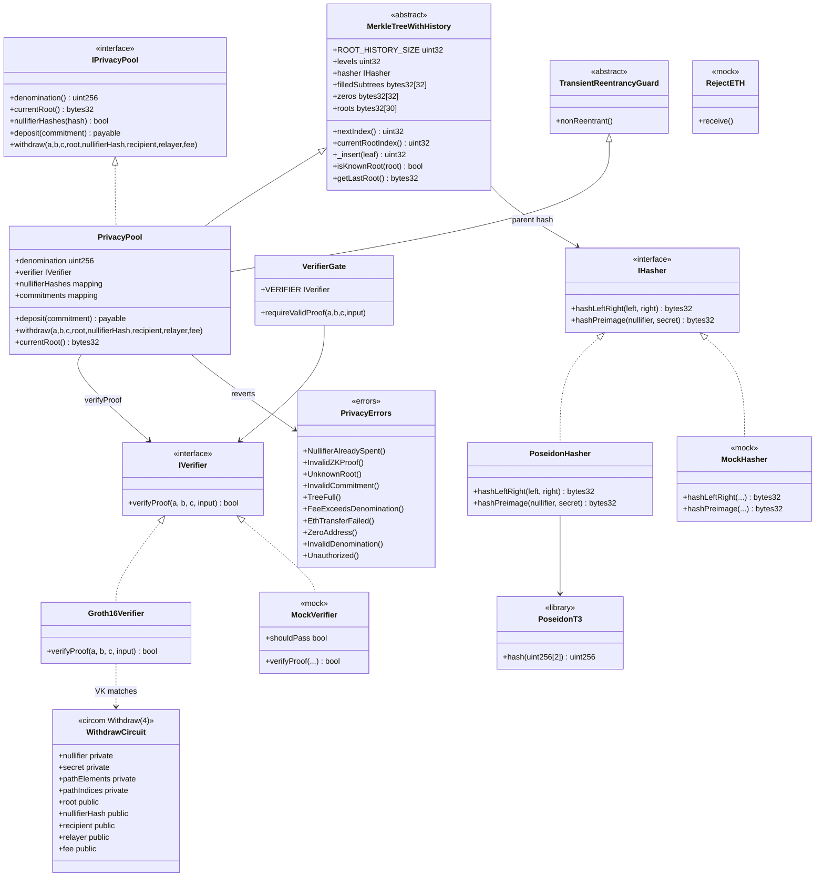

# Class diagram — ZK-SNARKs & Privacy Protocols

Structural view of contracts, circuits, libraries, and interfaces (module 17, **v1 implemented**).  
**Sync:** 2026-09-13 · Suite **65 PASS**.

## Diagram (Mermaid)

---

## Key relationships

| Relationship | Description |
|--------------|-------------|
| Pool → Hasher | On-chain Poseidon nodes; commitment computed off-chain |
| Pool → MerkleTreeWithHistory | Deposit inserts a leaf; ring of 30 roots |
| Pool → Verifier | Withdraw only with a valid Groth16 proof |
| Pool → nullifierHashes | One hash = one withdraw |
| Circuit → Verifier | 5 public signals in the same order |
| Relayer | EOA/`msg.sender` of withdraw; receives `fee` |

---

## Design notes

- `TransientReentrancyGuard` (Cancun) + CEI: nullifier **before** the Yul ETH `call`.
- Merkle: fixed arrays + `_packedIndices` (no index mappings).
- Lab: **levels = 4**; change the circuit + re-export the VK for another depth.
- Suite: **65 PASS**. [`GAS-EN.md`](./GAS-EN.md) · [`SWC-AUDIT-EN.md`](./SWC-AUDIT-EN.md) · flows: [`diagrama-de-flujo-EN.md`](./diagrama-de-flujo-EN.md) / [`flujograma-EN.md`](./flujograma-EN.md).
