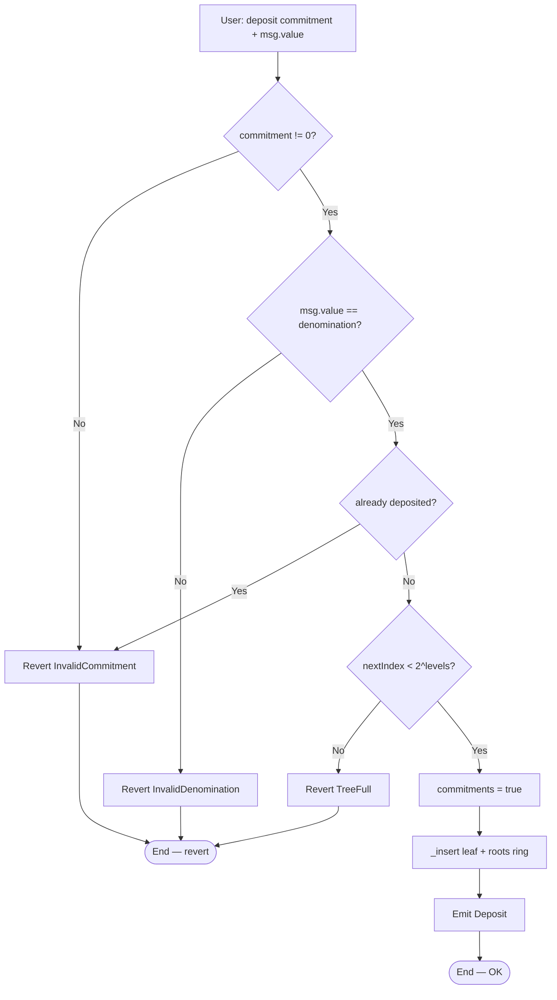
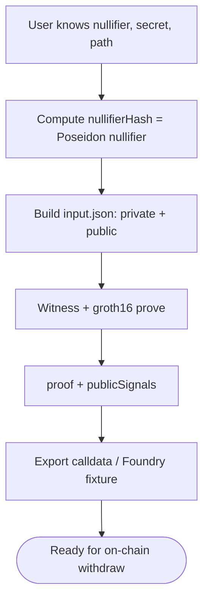
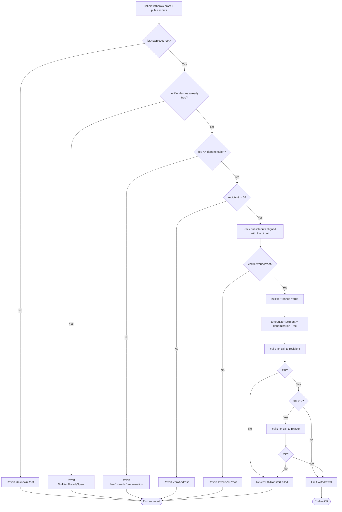
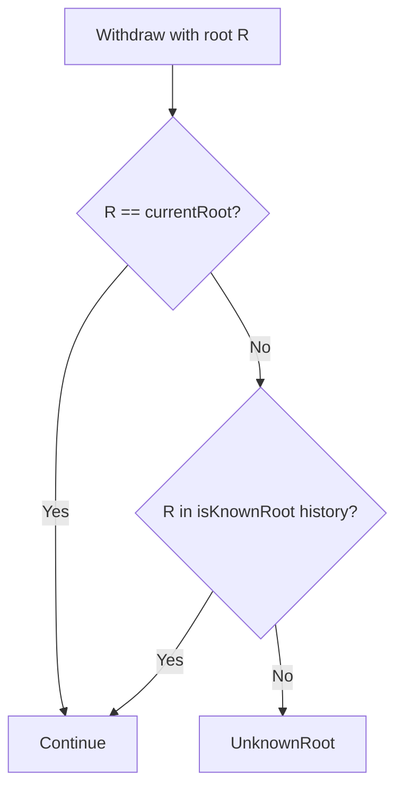
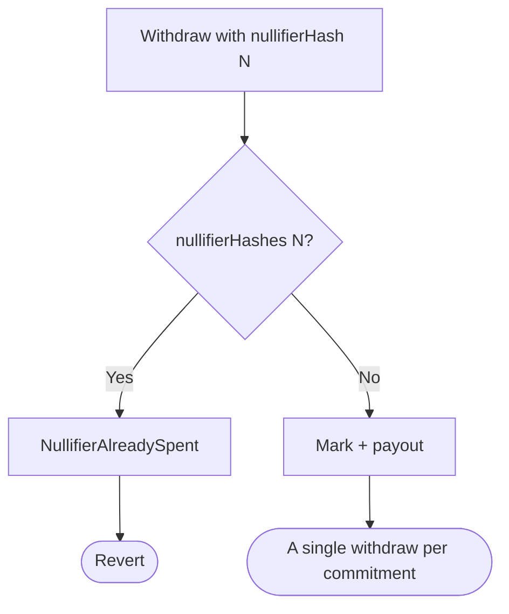
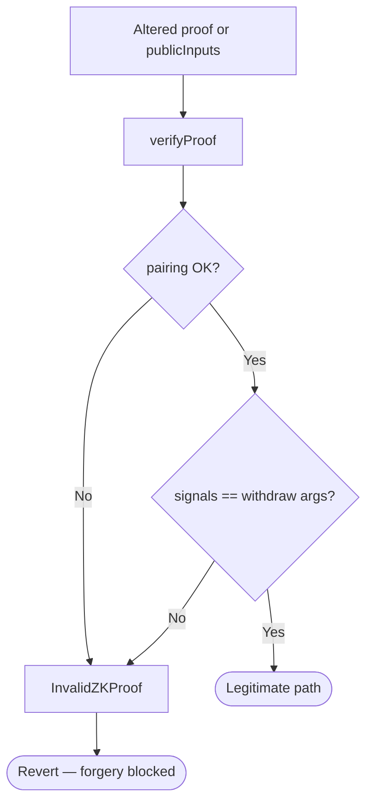
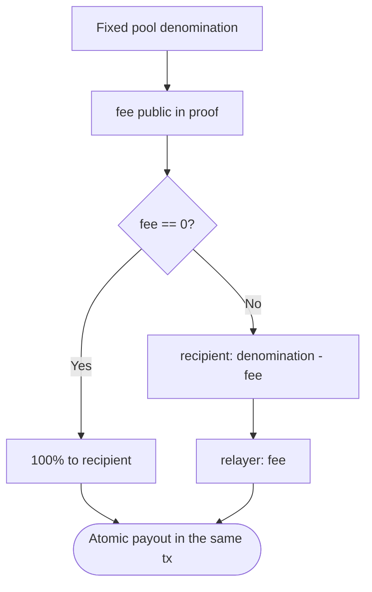

# Flow diagram — Deposit, prove, and withdraw

Internal decision flows of the pool, Merkle tree, and ZK verification (module 17, **v1 implemented**).  
**Sync:** 2026-09-13.

## 1. deposit (commitment + Merkle)

> `commitment = Poseidon(nullifier, secret)` off-chain. Guard: **transient reentrancy**.

---

## 2. Proof generation (off-chain — Circom / SnarkJS)

---

## 3. withdraw (root → proof → nullifier → payout)

> CEI: mark `nullifierHashes` **before** the ETH `call`s (Yul, no returndata). Transient reentrancy.

---

## 4. Historical root validation

---

## 5. Anti double-spend (nullifier)

---

## 6. Invalid / tampered proof

---

## 7. Relayer fee split

---

## Related docs

- UML: [`diagrama-de-clases-EN.md`](./diagrama-de-clases-EN.md)
- E2E: [`flujograma-EN.md`](./flujograma-EN.md)
- Index: [`README-EN.md`](./README-EN.md)
