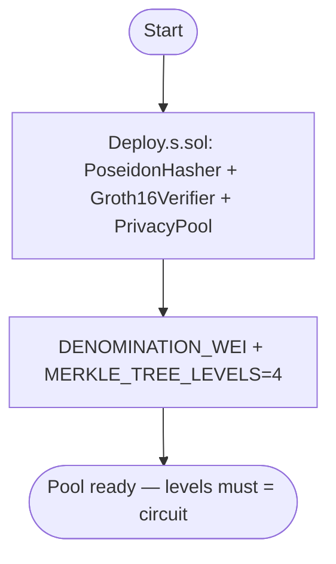
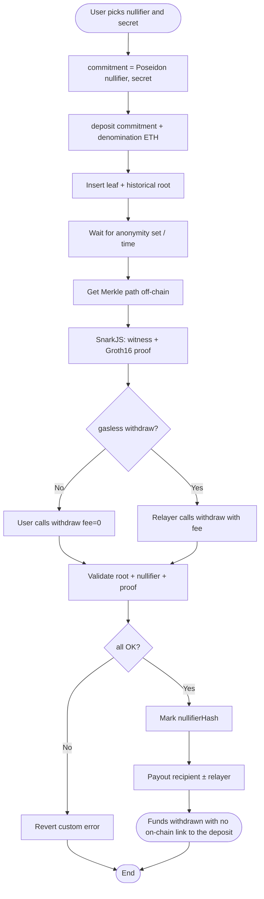
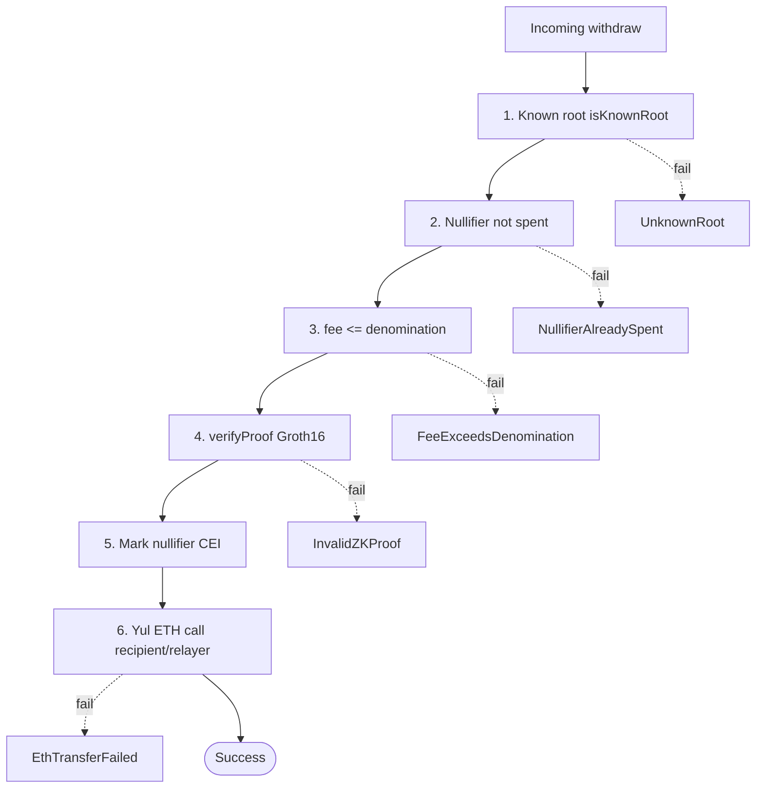
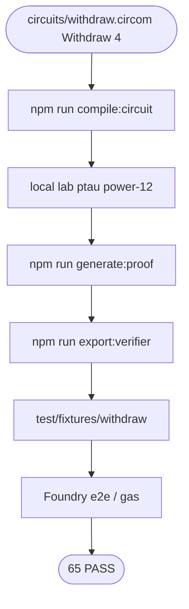
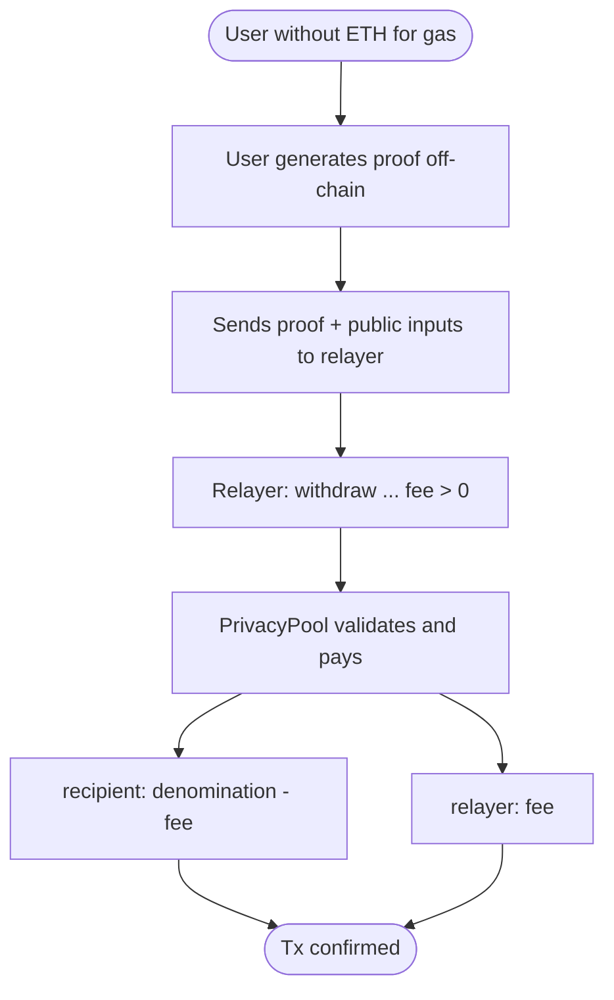

# Flowchart — Full Privacy Pool cycle (ZK-SNARKs)

End-to-end flow between users, circuit, pool, verifier, and relayer (module 17, **v1 implemented**).  
**Sync:** 2026-09-13 · **65 PASS**.

## Actors

| Actor | Role |
|-------|------|
| Depositor | Generates `(nullifier, secret)`, computes the commitment, calls `deposit` |
| Withdrawer | Witness + Groth16 proof; calls `withdraw` (or via relayer) |
| Relayer | Pays gas; receives `fee` bound to the proof |
| PrivacyPool | Leaves, roots, nullifiers, verify, Yul payout |
| Groth16Verifier | Alt_BN128 pairing (`ecPairing` `0x08`) |
| Circom / SnarkJS | `Withdraw(4)`, fixtures, VK export |
| Deployer | `Deploy.s.sol`: hasher + verifier + pool |
| CI / Foundry | Unit, fuzz, gas snapshot, e2e fixture |

---

## Flowchart — Deploy

---

## Main flowchart — Deposit → Prove → Withdraw

---

## Flowchart — Withdraw defense layers

---

## Flowchart — Circuit toolchain (lab)

---

## Flowchart — Gasless relayer

---

## Happy / failure path matrix

| Scenario | Expected result |
|----------|-----------------|
| Deposit with `msg.value == denomination` | Leaf inserted + `Deposit` |
| Withdraw valid proof + historical root | Payout + nullifier marked |
| Same `nullifierHash` twice | `NullifierAlreadySpent` |
| Never-seen root | `UnknownRoot` |
| Altered proof / signals | `InvalidZKProof` |
| `fee > denomination` | `FeeExceedsDenomination` |
| Recipient/relayer rejects ETH | `EthTransferFailed` |

---

## Related diagrams

- Type structure: [`diagrama-de-clases-EN.md`](./diagrama-de-clases-EN.md)
- Internal decisions: [`diagrama-de-flujo-EN.md`](./diagrama-de-flujo-EN.md)
- Phases / gas / SWC: [`planificacion-EN.md`](./planificacion-EN.md) · [`GAS-EN.md`](./GAS-EN.md) · [`SWC-AUDIT-EN.md`](./SWC-AUDIT-EN.md)
- Index: [`README-EN.md`](./README-EN.md)
